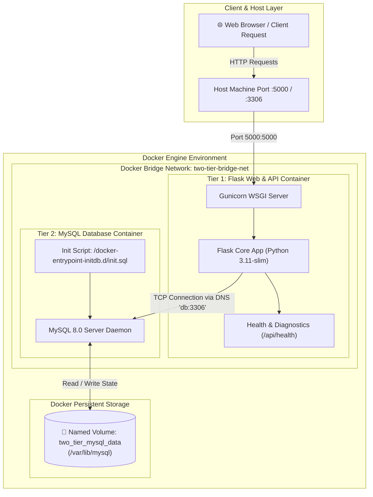
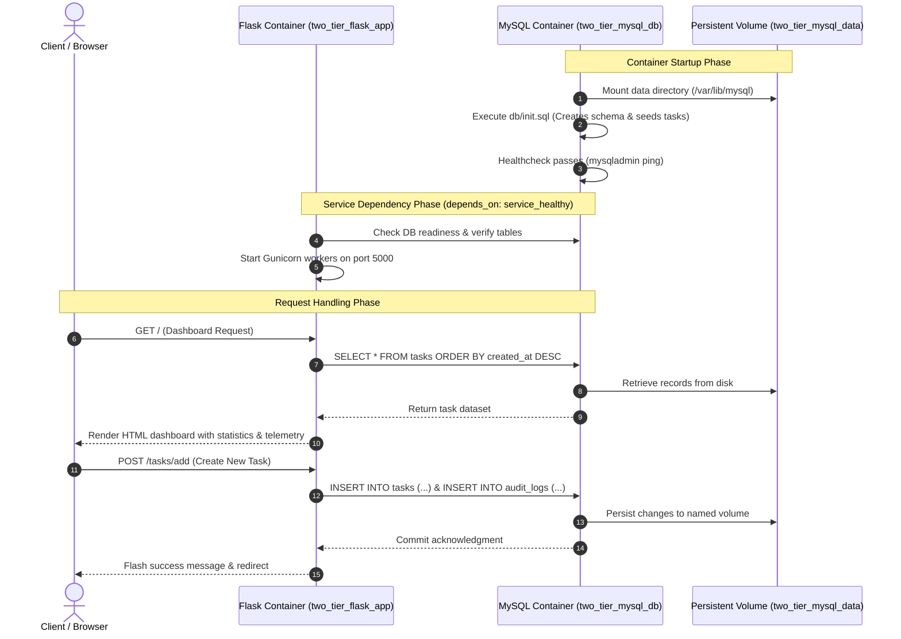

# Containerized Two-Tier Web Application

> **Tech Stack:** Docker | Docker Compose | Flask (Python 3.11) | MySQL 8.0 | Linux

A production-grade, containerized two-tier web application built with **Flask** (Tier 1: Presentation & API logic) and **MySQL 8.0** (Tier 2: Relational Database Storage). The architecture demonstrates custom Docker bridge network isolation, persistent named volume storage, automated health checking, environment variable credential management, and multi-container orchestration with Docker Compose.

---

## Architecture & Workflow

The diagram below illustrates the end-to-end container architecture, network isolation, volume mounting, and multi-tier request lifecycle:



---

## Workflow Lifecycle



---

## Core Key Features & Highlights

- **Two-Tier Microservice Separation:** Strict decoupling of Flask application logic and MySQL database layer.
- **Docker Custom Bridge Networking:** Dedicated `two-tier-bridge-net` enabling internal container DNS resolution (`db:3306`) without exposing database ports to the public network unless explicitly desired.
- **Data Persistence with Docker Volumes:** Database records and schemas reside in a named volume (`two_tier_mysql_data`), surviving container stop, removal, and rebuild operations.
- **Automated Multi-Container Orchestration:** Single-command bootstrap with `docker compose up -d` managing service dependencies (`condition: service_healthy`) and startup ordering.
- **Hardened Container Security:**
  - Non-root user (`appuser`) in the Flask Dockerfile.
  - Multi-stage dependency hygiene minimizing image attack surface.
  - URL-encoded, centralized credential management using `.env`.
- **Live Healthcheck & Diagnostics:** Real-time container telemetry reporting hostnames, DB connectivity status, query latency, and audit logs.
- **Full CRUD & Dynamic UI:** Modern dark-theme glassmorphism interface with task creation, priority flags, live status transitions, search filtering, and REST API endpoints.

---

## Project Structure

```
Two-Tier Web Application/
├── app/
│   ├── static/
│   │   ├── css/
│   │   │   └── style.css          # Modern dark-theme glassmorphic styling
│   │   └── js/
│   │       └── main.js            # Client-side search, filtering, and modals
│   ├── templates/
│   │   ├── base.html              # Base layout with navbar, footer, health modal
│   │   └── index.html             # Dashboard with telemetry, statistics, task board
│   ├── __init__.py                # App package initialization
│   ├── app.py                     # Flask routes, REST APIs, and startup retry logic
│   ├── config.py                  # Environment-driven database configuration
│   └── models.py                  # SQLAlchemy models (Task, AuditLog)
├── db/
│   └── init.sql                   # MySQL initial schema & seed datasets
├── .dockerignore                  # Optimization rules for Docker build context
├── .env.example                   # Template for environment configuration
├── .gitignore                     # Git exclusion rules for secrets and caches
├── docker-compose.yml             # Multi-container orchestration definition
├── Dockerfile                     # Optimized Python 3.11-slim container image
├── requirements.txt               # Pinned Python package dependencies
└── README.md                      # Comprehensive project documentation
```

---

## Environment Configuration

Copy `.env.example` to create your local `.env` configuration file:

```bash
cp .env.example .env
```

| Variable | Description | Default / Example |
|---|---|---|
| `MYSQL_ROOT_PASSWORD` | MySQL root administrative password | `root_secret_pwd_2026` |
| `MYSQL_DATABASE` | Target database name | `app_db` |
| `MYSQL_USER` | Non-root application database username | `flask_user` |
| `MYSQL_PASSWORD` | Password for application database user | `flask_secret_pwd_2026` |
| `MYSQL_PORT` | MySQL service port | `3306` |
| `DB_HOST` | Internal Docker DNS host of database container | `db` |
| `APP_PORT` | Host exposed port for Flask web app | `5000` |
| `FLASK_ENV` | Application environment (`production` / `development`) | `production` |
| `SECRET_KEY` | Flask session and cookie encryption key | `super-secret-key-12345` |

---

## Prerequisites

- **Docker Engine:** Version 20.10.0 or higher
- **Docker Compose:** Version 2.0.0 or higher (or Docker Desktop on Windows/macOS)

---

## Quickstart & Deployment

### 1. Build and Start All Containers
Launch both the Flask web tier and MySQL database tier in detached mode:

```bash
docker compose up --build -d
```

### 2. Verify Running Containers
Check the health status and network attachments of the containers:

```bash
docker compose ps
```

*Expected output:*
```
NAME                 IMAGE                     COMMAND                  SERVICE   CREATED         STATUS                    PORTS
two_tier_flask_app   two-tier-web-app-web      "gunicorn --bind 0.0…"   web       1 minute ago    Up 1 minute (healthy)     0.0.0.0:5000->5000/tcp
two_tier_mysql_db    mysql:8.0                 "docker-entrypoint.s…"   db        1 minute ago    Up 1 minute (healthy)     0.0.0.0:3306->3306/tcp
```

### 3. Access the Application
Open your web browser and navigate to:
- **Web UI Dashboard:** [http://localhost:5000](http://localhost:5000)
- **Health & Telemetry API:** [http://localhost:5000/api/health](http://localhost:5000/api/health)
- **Tasks JSON API:** [http://localhost:5000/api/tasks](http://localhost:5000/api/tasks)
- **Audit Logs API:** [http://localhost:5000/api/logs](http://localhost:5000/api/logs)

---

## Verification & Testing Guide

### 1. Inspect Docker Bridge Network
Verify that both containers are connected to the custom bridge network:

```bash
docker network inspect two-tier-bridge-net
```

### 2. Test Persistent Storage Resilience
Verify that database records survive container recreation:

```bash
# Add a new task in the Web UI or via API, then stop and remove containers
docker compose down

# Restart the containers without rebuilding volume
docker compose up -d

# Check the UI at http://localhost:5000 - your data remains intact!
```

### 3. View Real-Time Container Logs
```bash
# View all logs
docker compose logs -f

# View Flask web tier logs only
docker compose logs -f web

# View MySQL database logs only
docker compose logs -f db
```

---

## Stopping & Teardown

```bash
# Stop and remove containers and network (preserves database data volume)
docker compose down

# Stop and remove containers, network, AND delete the database volume
docker compose down -v
```
